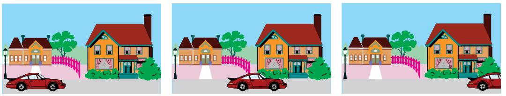
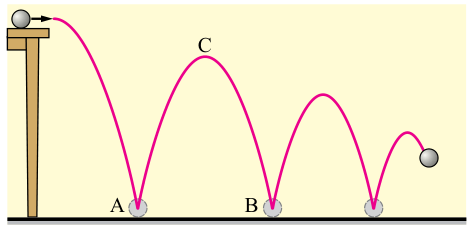
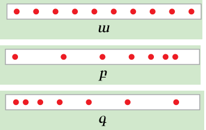

# Chapter III — first practice draft batch

**Current status (15C.2):** John accepted these exact eight offline v1 questions on 2026-10-13. Fresh whole-bank comparison, committed staging and exact QA passed; authenticated site workflow remains pending. [Current staging record](chapter-iii-batch-01-staging.md). The original question wording below is unchanged. [Plan and scope](chapter-iii-preparation.md).

Answer letters below are editorial reference labels. Existing server-side answer shuffling remains authoritative when items are eventually delivered.

## U03-PREP-C01 — PHY7-U03-S01

**Source:** §14, p.43, figure 36. **Evidence:** `application`. **Programme:** M1, M2 (direct).

Նկարում նույն ավտոմեքենան պատկերված է տարբեր պահերի։ Տներն ու ծառերը գետնի նկատմամբ անշարժ են։ Ո՞ր պնդումն է հաստատվում նկարով։

- **A.** Ավտոմեքենայի արագությունը գնալով մեծանում է։
- **B.** Ավտոմեքենայի դիրքը տների նկատմամբ փոխվում է։
- **C.** Ավտոմեքենան տների նկատմամբ դադարի վիճակում է։
- **D.** Ավտոմեքենան բոլոր երեք պահերին նույն տան դիմաց է։

**Ճիշտ պատասխան՝ B։** Ավտոմեքենան տարբեր պահերին տարբեր դիրքեր է զբաղեցնում տների նկատմամբ։ Ուրեմն այն շարժվում է տների նկատմամբ։ Նկարում պահերի միջև անցած ժամանակը նշված չէ, ուստի արագության փոփոխության մասին եզրակացնել չենք կարող։

**Հուշում 1.** Հաշվարկման մարմին ընտրիր նկարում պատկերված տներից մեկը։

**Հուշում 2.** Համեմատիր ավտոմեքենայի դիրքն այդ տան նկատմամբ երեք պատկերներում։

**Distractor checks:**

- A: Դիրքերի նկարից եզրակացնում է արագության փոփոխություն՝ առանց ժամանակի տվյալների։
- C: Չի նկատում դիրքի փոփոխությունը ընտրված հաշվարկման մարմնի նկատմամբ։
- D: Չի համեմատում նույն ավտոմեքենայի դիրքերը երեք պատկերներում։

**Author note:** Textbook figure is familiar practice stimulus; no claim of protected novelty. The removed caption would state the answer.

## U03-PREP-C02 — PHY7-U03-S02

**Source:** §15, pp.45–46; p.48, question 2. **Evidence:** `misconception_diagnosis`. **Programme:** M3 (derived_supporting).

Նույն ավտոբուսի համար լուծում են երկու խնդիր. 1) որոշել երկու քաղաքների միջև նրա շարժման ժամանակը, երբ անցած ճանապարհը շատ մեծ է ավտոբուսի երկարությունից, 2) որոշել անշարժ դիտորդի մոտով ավտոբուսի ամբողջությամբ անցնելու ժամանակը։ Ո՞ր դեպքում կարելի է ավտոբուսը համարել նյութական կետ։

- **A.** Երկու դեպքում էլ, քանի որ ավտոբուսը շարժվում է։
- **B.** Ոչ մի դեպքում, քանի որ ավտոբուսը մեծ մարմին է։
- **C.** Միայն երկրորդ դեպքում։
- **D.** Միայն առաջին դեպքում։

**Ճիշտ պատասխան՝ D։** Առաջին խնդրում ավտոբուսի երկարությունը կարելի է անտեսել։ Երկրորդ խնդրում պետք է հաշվի առնել նրա երկարությունը, քանի որ դիտորդի մոտով պետք է անցնի ամբողջ ավտոբուսը։

**Հուշում 1.** Մարմինը նյութական կետ համարելը կախված է խնդրի պայմաններից։

**Հուշում 2.** Ո՞ր խնդրի պատասխանը կփոխվի, եթե ավտոբուսի երկարությունը փոխվի։

**Distractor checks:**

- A: Նյութական կետի մոդելը կապում է միայն շարժվելու հետ։
- B: Մոդելի կիրառելիությունը որոշում է միայն մարմնի մեծությամբ։
- C: Շփոթում է այն դեպքերը, երբ մարմնի երկարությունը պետք է հաշվի առնել։

**Author note:** Intentional textbook practice variant of p.48 train example; changing vehicle does not create independent reasoning coverage.

**Image decision:** Both tasks state exactly whether body length matters; a decorative bus picture supplies no needed information.

## U03-PREP-C03 — PHY7-U03-S03

**Source:** §15, p.47, figure 40. **Evidence:** `core_understanding`. **Programme:** M3 (direct).

Գնդիկը A կետում բախվում է գետնին, այնուհետև անցնում է C կետով և B կետում նորից բախվում գետնին։ A-ից B շարժվելիս նրա անցած ճանապարհը ո՞րն է։

- **A.** ACB կոր գծի երկարությունը։
- **B.** A և B կետերը միացնող ուղիղ հատվածի երկարությունը։
- **C.** C կետի բարձրությունը գետնից։
- **D.** AC կոր գծի երկարությունը։

**Ճիշտ պատասխան՝ A։** Անցած ճանապարհը հետագծի այն մասի երկարությունն է, որով շարժվել է մարմինը։ Գնդիկը A-ից B շարժվել է C կետով անցնող կոր գծով, ուստի պետք է վերցնել ACB կոր գծի ամբողջ երկարությունը։

**Հուշում 1.** Նկարում հետևիր գնդիկի շարժմանը A կետից մինչև B կետը։

**Հուշում 2.** Անցած ճանապարհը որոշելիս հաշվի է առնվում անցած ամբողջ հետագիծը։

**Distractor checks:**

- B: Անցած ճանապարհը նույնացնում է սկզբնական և վերջնական կետերի հեռավորության հետ։
- C: Ճանապարհի փոխարեն ընտրում է առավելագույն բարձրությունը։
- D: Հաշվի է առնում միայն ճանապարհի մի մասը։

**Author note:** Direct practice of the book figure and explanation. No use of untaught acceleration, flight-time or energy laws.

## U03-PREP-C04 — PHY7-U03-S04

**Source:** §16, pp.49–50; p.53, question 3 diagram. **Evidence:** `application`. **Programme:** M1 (direct).

Երեք փորձերում շարժվող սայլակի կաթոցիկից կաթիլներն ընկնում են հավասար ժամանակամիջոցներով։ Նկարում երևում են դրանց հետքերը։ Ո՞ր շարքում են հետքերը համապատասխանում հավասարաչափ շարժմանը։

- **A.** Միայն բ շարքում։
- **B.** Միայն գ շարքում։
- **C.** Միայն ա շարքում։
- **D.** Բոլոր երեք շարքերում։

**Ճիշտ պատասխան՝ C։** ա շարքում հարևան հետքերի հեռավորությունները հավասար են։ Հավասար ժամանակամիջոցներում սայլակն անցել է հավասար ճանապարհներ։ բ և գ շարքերում այդ հեռավորությունները տարբեր են։

**Հուշում 1.** Համեմատիր հարևան հետքերի միջև եղած հեռավորությունները։

**Հուշում 2.** Հավասար ժամանակամիջոցներին հավասարաչափ շարժման դեպքում համապատասխանում են հավասար ճանապարհներ։

**Distractor checks:**

- A: Անհավասար հեռավորություններով հետքերը համարում է հավասարաչափ շարժման նշան։
- B: Աճող հեռավորությունները շփոթում է հավասար հեռավորությունների հետ։
- D: Հավասար ժամանակամիջոցները բավարար է համարում՝ անտեսելով անցած ճանապարհները։

**Author note:** Intentional textbook practice variant. The inference is compatibility with sampled uniform-motion evidence, not proof at all smaller intervals. Equal time is explicitly supplied.

## U03-PREP-C05 — PHY7-U03-S05

**Source:** §16, pp.51–52, direction of speed. **Evidence:** `misconception_diagnosis`. **Programme:** A1 (derived_supporting).

Ուղիղ ճանապարհով երկու հեծանվորդ շարժվում են հավասարաչափ՝ յուրաքանչյուրը 4 մ/վ արագությամբ։ Մեկը շարժվում է դեպի արևելք, մյուսը՝ դեպի արևմուտք։ Ո՞ր պնդումն է ճիշտ։

- **A.** Արագությունների թվային արժեքները հավասար են, իսկ ուղղությունները՝ հակառակ։
- **B.** Արագությունները հավասար են և՛ թվային արժեքով, և՛ ուղղությամբ։
- **C.** Դեպի արևելք շարժվող հեծանվորդի արագության թվային արժեքն ավելի մեծ է։
- **D.** Հակառակ ուղղություններով շարժվելիս արագությունների թվային արժեքները չեն կարող հավասար լինել։

**Ճիշտ պատասխան՝ A։** Երկու հեծանվորդն էլ յուրաքանչյուր վայրկյանում անցնում են 4 մ ճանապարհ։ Արագությունների թվային արժեքները հավասար են, բայց շարժման ուղղությունները հակառակ են։

**Հուշում 1.** Առանձին համեմատիր արագությունների թվային արժեքները և շարժման ուղղությունները։

**Հուշում 2.** 4 մ/վ գրառումը տվյալ խնդրում երկու հեծանվորդի համար էլ նույնն է։

**Distractor checks:**

- B: Հավասար թվային արժեքից եզրակացնում է նաև հավասար ուղղություն։
- C: Աշխարհագրական ուղղությանը վերագրում է ավելի մեծ արագության արժեք։
- D: Թվային արժեքը և ուղղությունը չի տարբերակում։

**Author note:** Supporting textbook extension. Not a new mandatory programme outcome; no vector addition or relative-speed calculation.

**Image decision:** The opposite directions and equal values are explicit; no diagram reading is required.

## U03-PREP-C06 — PHY7-U03-S06

**Source:** §16, p.51, p.53 questions 8–9; §17, p.54 problem 1. **Evidence:** `application`. **Programme:** M5 (direct).

Առաջին հեծանվորդի արագությունը 9 մ/վ է, իսկ երկրորդինը՝ 36 կմ/ժ։ Ո՞ր հեծանվորդն է ավելի արագ շարժվում։

- **A.** Առաջինը, քանի որ 36 կմ/ժ-ը 3,6 մ/վ է։
- **B.** Երկուսն էլ նույն արագությամբ, քանի որ 9 մ/վ-ը 36 կմ/ժ է։
- **C.** Համեմատել հնարավոր չէ, քանի որ միավորները տարբեր են։
- **D.** Երկրորդը, քանի որ 36 կմ/ժ-ը 10 մ/վ է։

**Ճիշտ պատասխան՝ D։** 36 կմ/ժ = 36 × 1000 մ / 3600 վ = 10 մ/վ։ Քանի որ 10 մ/վ > 9 մ/վ, երկրորդ հեծանվորդն ավելի արագ է շարժվում։

**Հուշում 1.** Արագությունները համեմատելու համար դրանք արտահայտիր նույն միավորով։

**Հուշում 2.** Օգտագործիր 1 կմ = 1000 մ և 1 ժ = 3600 վ կապերը։

**Distractor checks:**

- A: Սխալ է ձևափոխում կմ/ժ միավորը մ/վ-ի։
- B: Կիրառում է սխալ փոխարկման գործակից։
- C: Տարբեր միավորները համարում է համեմատության անհաղթահարելի խոչընդոտ։

**Author note:** Intentional practice of a taught conversion-and-comparison procedure. Compared with U01 single-quantity conversion; quotient-unit conversion is the chapter-specific demand.

**Image decision:** This task requires unit conversion; a picture would provide no additional evidence.

## U03-PREP-C07 — PHY7-U03-S07

**Source:** §16, pp.50–52; §17, pp.54–55. **Evidence:** `application`. **Programme:** A1 (direct_additional).

Հեծանվորդը հավասարաչափ շարժվելով՝ 15 վ-ում անցնում է 90 մ ճանապարհ։ Նույն արագությամբ շարժվելիս որքա՞ն ճանապարհ կանցնի 25 վ-ում։

- **A.** 90 մ։
- **B.** 150 մ։
- **C.** 375 մ։
- **D.** 6 մ։

**Ճիշտ պատասխան՝ B։** Նախ գտնենք արագությունը՝ v = 90 մ / 15 վ = 6 մ/վ։ Այնուհետև՝ s = 6 մ/վ × 25 վ = 150 մ։

**Հուշում 1.** Սկզբում որոշիր, թե հեծանվորդը մեկ վայրկյանում որքան ճանապարհ է անցնում։

**Հուշում 2.** Գտած արագությունը բազմապատկիր նոր ժամանակամիջոցով։

**Distractor checks:**

- A: Տարբեր տևողությունների համար պահպանում է նույն ճանապարհը։
- C: Բազմապատկում է երկու ժամանակների թվային արժեքները։
- D: Արագության թվային արժեքը ներկայացնում է որպես ճանապարհ։

**Author note:** Intentional two-step formula practice. Explicit uniform-motion premise; no average-speed or acceleration inference.

**Image decision:** All distances and times are supplied; a schematic would only repeat the text.

## U03-PREP-C08 — PHY7-U03-S08

**Source:** §18, pp.57–58, procedure steps 6–8. **Evidence:** `transfer_reasoning`. **Programme:** A1 (direct_additional).

Աշակերտը ցանկանում է որոշել խողովակում հավասարաչափ շարժվող օդի պղպջակի արագությունը։ Նա խողովակի վրա նշել է A և B կետերը։ Փորձի սկզբում պղպջակը դեռ չի հասել A կետին։ Ո՞ր չափումները պետք է կատարի։

- **A.** Չափի խողովակի ամբողջ երկարությունը և A-ից B անցնելու ժամանակը։
- **B.** Չափի A և B կետերի հեռավորությունը և փորձի սկզբից մինչև B կետ հասնելն անցած ժամանակը։
- **C.** Չափի A և B կետերի հեռավորությունը և հենց A-ից B անցնելու ժամանակը։
- **D.** Չափի պղպջակի երկարությունը և A-ից B անցնելու ժամանակը։

**Ճիշտ պատասխան՝ C։** Արագությունը հաշվելու համար պետք է ճանապարհը բաժանել հենց այդ ճանապարհն անցնելու ժամանակին։ Ուստի չափվում են A և B կետերի հեռավորությունն ու պղպջակի՝ A-ից B անցնելու ժամանակը։

**Հուշում 1.** v = s/t բանաձևում ճանապարհն ու ժամանակը պետք է վերաբերեն շարժման նույն տեղամասին։

**Հուշում 2.** Համեմատիր, թե յուրաքանչյուր տարբերակում որտեղից է սկսվում ժամանակի չափումը և ինչ երկարություն է չափվում։

**Distractor checks:**

- A: Ընտրված ժամանակամիջոցին համապատասխանեցնում է ամբողջ սարքի երկարությունը։
- B: Ընտրված ճանապարհին համապատասխանեցնում է այլ սկզբով չափված ժամանակը։
- D: Մարմնի սեփական երկարությունը շփոթում է նրա անցած ճանապարհի հետ։

**Author note:** The starting position is explicit so timing the entire experiment cannot coincide with A-to-B timing. This is measurement planning, not evidence of performed practical competence.

**Image decision:** A and B are fully defined as marks on one tube; the source section has no apparatus figure and no geometric feature is needed.

