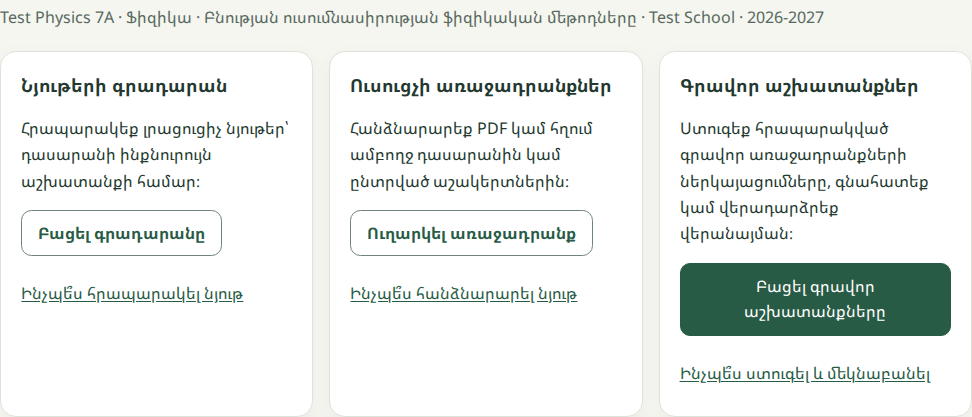

# B.12.3 — Cross-role usability acceptance

**2026-10-29 — B.12.3 account/session recovery delivered; stabilization remains open.** [PR360](https://github.com/johnvanesyan-arch/HaiEdu/pull/360) gives every affected interactive logout entry point one outcome controller: confirmed local clearing, an explicit retry for a retained session, or a read-only status check for an unknown result. New logins release stale recovery locks; old results cannot change the newer account. Writing saves before logout, unknown submission/feedback publication stays guarded, and account input/results are fenced on identity changes. Temporary account/identity reads expose retry without forcing logout. Required PR/main gates pass (**1,569 unit/integration; 314 native**); [current-source production QA](https://github.com/johnvanesyan-arch/HaiEdu/actions/runs/40894872170) passes **196/196**, 54+54 isolation and run-owned cleanup. All **23 changed frontend files** match the public runtime. No production learner submission or grade is manufactured. [Contract/consumer audit](account-session-recovery.md) · [Evidence](evidence/workspace-stabilization-account-release-20261029.json) · [Single defect register](workspace-defect-register.md). **Next: focused process-simplicity review of the four core teacher/student journeys**, then remaining defect dispositions and John's final usability decision. **B.12.3/B.12 remain open; subject expansion stays paused.** All 45 mappings, content/audio approvals, English C47 hold and the separate four-subject gate remain.

**Historical 2026-10-29 — writing recovery batch 2 checkpoint; superseded by the current delivery above.** [PR358](https://github.com/johnvanesyan-arch/HaiEdu/pull/358) reconciles lost submission replies through authorized history reads, preserves text during an unknown outcome, prevents duplicate sends and unsafe navigation, and offers a clear status-check/reload action with keyboard focus. The real learner shell and computed 200% text are covered; writing and course labels reflow on narrow screens. All five PR/main gates pass (**1,561 unit/integration; 281 native**). [Current-source live QA](https://github.com/johnvanesyan-arch/HaiEdu/actions/runs/40861216601) passes **196/196**, 54+54 isolation and run-owned cleanup; thirty runner hashes plus the course stylesheet give **31** public byte matches. Positive existing reviewed-work/feedback evidence is from school A; school B verifies discovery/navigation without a reviewed response. No production learner submission or grade is manufactured. [Evidence](evidence/workspace-stabilization-writing-release-20261029.json) · [Single defect register](workspace-defect-register.md). At the writing checkpoint, account/logout recovery was next; the current next slice is recorded above. Logical, simple processes remain required; **B.12.3/B.12 are open and subject expansion stays paused**. All 45 mappings, earlier content/audio approvals, English C47 hold and the separate four-subject gate remain.

2026-10-29 Asia/Yerevan · Stabilization in progress; final owner usability decision pending.

John has not accepted the workspace. Earlier technical checks below are bounded baseline evidence. The [single defect register and process standard](workspace-defect-register.md) govern the current audit and fixes. Forms and submissions must be logical, simple and easy to follow; no known P0/P1 defect may remain in the agreed journeys at final acceptance. Subject expansion stays paused.

This is the remaining workspace exit, covering the available production programmes and neutral fixtures. It does not activate subjects, change content approvals or close the separate full four-subject gate. The 45 capability/dependency rows remain unchanged. Speaking stays classroom-assessed. WRITE-CREATE, RESOURCE-SUBMIT, DEMO-01 and batch feedback remain separately scoped.

## Acceptance matrix

| ID | Requirement | Technical evidence and scope |
| --- | --- | --- |
| U01 | Shared Forest navigation, context and predictable account/logout across roles | Current required native suite: real page layouts at 360/768/1280 px and 200% text; school/master/reviewer presentation uses simulated authorization. Student/teacher/school-admin production accounts are designated fixtures. No live master-admin session is claimed. |
| U02 | Teacher publishes/assigns to class or selected learners → intended My work → exact PDF → cancellation | [Guarded production run 40842002528](https://github.com/johnvanesyan-arch/HaiEdu/actions/runs/40842002528): **196/196**, 54 before + 54 after isolation, 30 frontend byte matches; run-owned synthetic resources/assignments only. Class send and learner download use Chromium; selected send/version/lifecycle checks use the guarded service. Same-class selected/excluded browser/SQL coverage is isolated. All four assignments are canceled, both resources withdrawn and six sessions close with HTTP 204. |
| U03 | Learner My work → exact writing unit → existing feedback → same-context return | Fresh production journeys pass for both schools: My work opens the exact writing unit and returns to the same context. School A opens the same pre-existing reviewed response and score/feedback in learner and teacher views; school B has no reviewed response. No production writing or grade is created. Complete submit/return/revise/assess lifecycle passes in isolated actual-SQL/native evidence. |
| U04 | Teacher Home → class → review → next work, with zero/unknown/failed states | Current native SQL Today/feedback journeys; current source review navigation and read-only production context. Zero pending work never hides Reviewed/Returned filters. |
| U05 | Archive search, history and restore | Current native directory/paging/stale-response checks plus fresh production archive discovery. Existing restore service/action evidence is reused where source is unchanged; no historical record is deleted. |
| U06 | Private draft protection, retry and account/logout boundaries | Current 314 native checks include returned/thrown/unknown logout, duplicate controls, stale/new-account lock recovery, exact draft save before logout, unresolved feedback publication, neutral account-read retry and old profile/email completion fences. The real account controller runs all five supported role projections with isolated Auth. Prior startup/revocation/two-tab guards remain. This is not live master-admin or real-device/AT acceptance. |
| U07 | Keyboard, readable focus, reduced motion and responsive layout | Shared skip link retains sufficient contrast under role themes and its actual main target remains focusable; both school pages have static links. Closing native coverage checks all 28 shared UX consumers at 360/768/1280 px and 100/200% text (168 cases), with reduced motion requested and business/auth modules isolated. The fixture explicitly resolves the role-pending presentation hold and models the guest landing; actual authenticated shell/functional journeys run separately. This does not remove the production role-routing guard. |
| U08 | Teacher loading budgets and bounded reads | [Fresh run 40842668480](https://github.com/johnvanesyan-arch/HaiEdu/actions/runs/40842668480) completes all **150** observations and 113 checks. Visible Home p95 **2.29 s cold /1.72 s reload**, selected class **1.33 s**, loaded navigation **42 ms**; unchanged **3 s /2 s /200 ms** limits pass. All forty Home observations have two application reads. Original polling clocks (2.60/2.22 s) and every sample remain in the report. Both sessions close; no work is manufactured. |
| U09 | Tenant/recipient, role and session restrictions | Existing server contracts retained; required SQL races/isolation plus guarded production before/after isolation. No service credentials in isolated browser tests. |
| U10 | Forty-five mappings, subject/grade neutrality and feature readiness | Compare the unchanged 45-row coverage document and source hashes; UI changes contain no subject/grade default. No future feature becomes live by renaming or approval. |
| U11 | Release and provenance | All five implementation PR/main gates pass (1,561 unit/integration; 273 native). Production release **708682d6267c62cb23410ecc8fa746d69be1e2dc** and thirty byte hashes match. Closing documentation/evidence and broader isolated checks leave runtime unchanged; required closing CI and exact-source Notion synchronization are delivery conditions. |
| U13 | Logical, simple, easy-to-follow processes | Purpose/context, necessary and ordered inputs, clear primary action, distinct draft/publication/assignment/send states, safe back/cancel/retry, retained input, acknowledged result and clear next destination. Normal/error/pending states require evidence under the [process standard](workspace-defect-register.md). Audit in progress; human usability is not inferred from technical counts. |
| U12 | Owner usability acceptance | Remains a human decision after the concrete review packet/results below. The project exit rule requires owner acceptance before further subject/chapter work. |

## Verified repairs

A delayed SDK startup session read can reject after INITIAL_SESSION has already opened a valid teacher Home. The old top-level await could produce an unhandled rejection and generic toast. The new auth-generation/settled-workspace guard ignores that superseded result. A genuine initial failure exposes the existing retry; unexpected dashboard data/render failures become a recoverable unknown state instead of an unhandled promise or invented zero. Refresh and logout ask before abandoning unsaved private feedback. No server authorization or session revocation check is removed.

This failure-injection reproduction establishes a real path to the reported symptom. The original user's exception was not captured, so its historical cause remains unconfirmed. UI-ERROR-01 cannot be described as historically diagnosed; if the generic message recurs in owner review, keep the gate open and obtain that exception.

The shared keyboard repair keeps the skip link readable under staff/student link colours, excludes it from generic student-link colouring and gives its actual main target keyboard focus, including pages with a pre-existing skip link. Both school pages gain static skip links and focusable mains. No business action or listener is added by that focus correction.

## Concrete owner review

The production delivery results above and the final performance evidence below form the technical review packet. Review is of the interface/workflows; content/audio/bank approvals remain accepted.

- [Teacher Home](https://www.haiedu.am/teacher?view=home): useful current work, classes and available next actions; no false progress or pending count.
- [Writing review](https://www.haiedu.am/teacher?view=review): choose class/unit and Pending/Returned/Reviewed/All; inspect the existing reviewed QA example without publishing another mark.
- [Teacher guide](https://www.haiedu.am/teacher-workflows.html): publication versus assignment, writing submission/review and the explicitly future PDF-response/custom-authoring capabilities.
- [Student My work](https://www.haiedu.am/index.html?view=work) and [Library](https://www.haiedu.am/materials.html): assigned work and optional browsing have distinct destinations; writing/feedback return retains context.
- [Account](https://www.haiedu.am/privacy.html): role-appropriate return and logout. School/master/reviewer homes retain their own navigation and authority.

Automated viewport/text enlargement is not an actual-device or assistive-technology survey. True browser-chrome zoom and screen-reader usability are not claimed from headless emulation. The owner may check 200% browser zoom on their actual browser and report any issue; complete WCAG certification or measured user engagement is not implied.

## Performance scope

The profile is Chromium at 1365×950 on a shared GitHub runner, unthrottled CPU and CDP 4G (150 ms, 1.6 Mbps down /750 Kbps up). Fresh contexts do not guarantee a cold Edge instance; same-context reload does not guarantee an HTTP-cache hit. These measurements recheck the existing visible-Home definition; they are not a human task-completion or actual-device survey. School A has an existing reviewed response; school B has none.

## Evidence and reuse

- [Production report](evidence/cross-role-usability-production-20261029.json): exact source, thirty frontend hashes, writing receipt scope, before/after isolation and run-owned cleanup.
- [Technical delivery index](evidence/cross-role-usability-release-20261029.json): implementation CI, native evidence, timing report, preservation hashes and earlier unchanged evidence.
- [Teacher entry points](evidence/cross-role-usability-teacher-entrypoints-20261029.png): captured during the guarded production run with the designated Physics test fixture.

The current slice changes no server source, dependencies, curriculum, audio or grades. Previously verified deployed SQL/Edge provenance is reused explicitly; this is not a new live server-hash attestation. The 45-row capability map is byte-identical to the prior checkpoint. The fixture JSON read by the new journey is explicitly listed in the QA dependency checker and workflow trigger. Initial native failures and their repairs remain in the technical index; no check was dropped.

## Owner decision record

Pending. A request to perform acceptance authorizes verification and fixes; it is not evidence that John has inspected and accepted the final result. No owner decision, human task-completion time or engagement metric is invented. Full B.12.3/B.12 and the English C47 hold remain until that decision is recorded.

## PROCESS-01/U13 focused simplicity review

[Four-journey review and state matrix](workflow-simplicity-review.md) records the current bounded implementation, unchanged contracts and evidence requirements. Current verification is pending. This advances U13 without substituting for U12/John's final usability decision. B.12.3/B.12 remain open and subject expansion stays paused.
