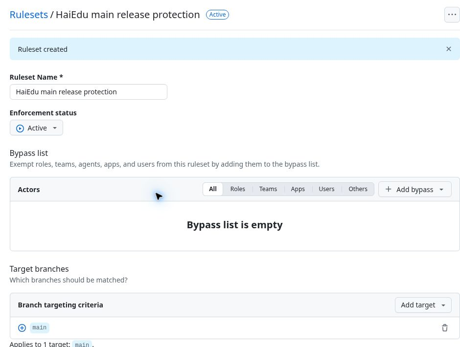

# Main-branch protection — 4 November 2026

**Configured and read back at13:22 Asia/Dubai.** John explicitly requested protection of the HaiEdu production source branch and passing release checks. This changes repository settings only. Application code, learning rules, database state and production deployment are unchanged. Main remains `7b88f1b18db4571f87b4eb7e120e12d6a584ffc6`; repository visibility remains public.

## Active rule

[HaiEdu main release protection](https://github.com/johnvanesyan-arch/HaiEdu/rules/26520838), repository ruleset26520838:

| Setting | Verified value |
|---|---|
| Enforcement | Active |
| Exact target | `refs/heads/main`; no exclusions |
| Pull requests | Required |
| Required check | `Platform release checks` |
| Accepted source | GitHub Actions, integration15368 |
| Base freshness | Strict; PR must be up to date with main |
| Check exception on branch creation | Disabled |
| Force pushes / deletion | Blocked |
| Bypass actors | Empty |
| Current owner bypass | `never` |
| Mandatory independent approval count | 0; separate review gate remains open |

The checked-in aggregate has `if: always()` and depends on `test`, `role-layout-browser`, `institutional-concurrency` and `phase3-postgres-17`; `scripts/check-release-readiness.mjs` requires every dependency to succeed. Requiring this exact aggregate preserves all five release jobs without duplicating settings. The persistent Vercel Production/Blocking check remains separately tracked and was not changed here.

## Verification and limitations

The prepared rule was saved through GitHub settings after GitHub account re-authentication. Fresh authenticated GETs of the ruleset, main branch and repository independently confirm active enforcement, the exact check/source, strictness, empty bypass, `current_user_can_bypass: never`, `main.protected: true`, unchanged main SHA and public visibility. [Privacy-safe receipt](../evidence/main-branch-protection-20261104.json).

This is a repository ruleset, not a classic branch-protection rule: the branch response's legacy `protection.enabled`/context subobject can remain false/empty. Active ruleset details plus `protected:true` are the applicable configuration evidence. No forbidden write to main, forced update, deletion or failing production merge was attempted as a test. No independent-review acceptance is inferred from settings readback.

PR-only delivery and required CI address the requested configuration gap. CODEOWNERS and meaningful independent risky-change review remain separately open under BF-01/BF-14; mandatory approval is not enabled without a designated available reviewer. The task does not authorize a new reviewer, access grant, policy waiver, curriculum release or BF-04 production rollout.

The BF-04 candidate `6c94f71867a351e1260b581e0f8c552d117f9dc8` had all five jobs passing in CI41798845353 (1,695 unit/integration,414 native, eight independent PostgreSQL17.6 recovery scenarios and13 PostgreSQL recovery/handler cases). The settings receipt is a documentation-only follow-up in the same draft PR401; its current-head checks remain required. Backup/restore verification is still missing, so no database migration or BF-04 deployment is performed.

