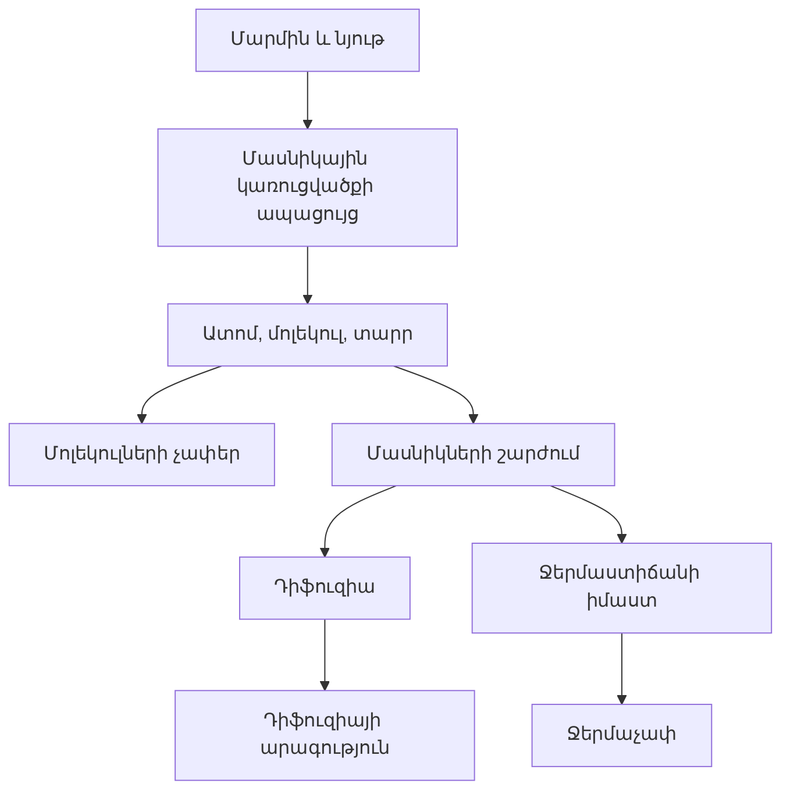

# Sprint 15B.1 — Ֆիզիկա 7, Գլուխ II-ի կառավարվող հիմք

**Կարգավիճակ՝** իրականացված է որպես վերանայման թեկնածու։ Սովորողներին հասանելի չէ։

## Նպատակ

Գլուխ II-ը՝ «Նյութի կառուցվածքը», ավելացնել կառավարվող բովանդակային շղթային՝ առանց դեռ հարցեր հրապարակելու կամ գործող Գլուխ I-ի փորձնական թողարկումը փոխելու։

Այս հատվածը կատարում է երեք նախապայման.

1. նոր հուշման/օգնության ուղեցույցը ստեղծվում է անմիջապես սևագիր կարգավիճակով և ստանում է անփոփոխ հեղինակման պատմության առաջին տարբերակը,
2. բազմագլուխ թողարկումը յուրաքանչյուր գլխի համար պահպանում է առանձին աղբյուրային համադրում և ակտիվացման պահին պահանջում է երեք գնահատման ձևանմուշ՝ ախտորոշիչ, վարժանք և յուրացման ստուգում,
3. Գլուխ II-ի պաշտոնական վերջնարդյունքները, թեմաները, թեկնածու հմտությունները և նախապայմանները գրանցվում են միայն `review`/`draft` կարգավիճակով։

## Աղբյուրների գերակայություն

| Դեր | Աղբյուր | Օգտագործում |
|---|---|---|
| Ղեկավարող | ՀՀ ԿԳՄՍ նախարարի N 40-Ն ծրագիր՝ N 36-Ն փոփոխությամբ, ուժի մեջ՝ 2026-08-14-ից | Վերջնարդյունքների և պարտադիր/լրացուցիչ ծավալի վերջնական աղբյուր |
| Ղեկավարող | Հանրակրթության պետական չափորոշիչ | Ընդհանուր կարողունակությունների հղումներ |
| Ղեկավարող | Ֆիզիկայի 7–12-րդ դասարանների առարկայական չափորոշիչ | Առարկայական համադրման աղբյուր. կետային համադրումը դեռ մասնագիտական հաստատման փուլում է |
| Օժանդակ | «Ֆիզիկա 7», 2023, Գլուխ II, տպագիր էջեր 23–41 | Բացատրությունների, օրինակների, լաբորատոր աշխատանքի և հմտությունների մանրատման աղբյուր |

Ծրագրային վերջնարդյունքների բառերը պահպանվել են՝ տպագրական վերջակետերն ու ստորակետերը տվյալների դաշտերին համապատասխան նորմալացնելով։ Պաշտոնական հավելվածում պարտադիր ցանկի հինգերորդ վերջնարդյունքի տեսանելի համարը բացակայում է. այդ հանգամանքը պահպանվել է տառադարձման նշման մեջ։

## Թեմաներ

| Կոդ | Հայերեն անվանում | Դասագրքային ընդգրկում |
|---|---|---|
| `PHY7-U02-T01` | Ֆիզիկական մարմին և նյութ. նյութի մասնիկային կառուցվածքը | §7 |
| `PHY7-U02-T02` | Ատոմներ, մոլեկուլներ և դրանց չափերը | §8, լաբորատոր աշխատանք 2 |
| `PHY7-U02-T03` | Մոլեկուլների շարժումը և դիֆուզիան | §10 |
| `PHY7-U02-T04` | Մոլեկուլների քաոսային շարժման արագությունը և ջերմաստիճանը | §11 |
| `PHY7-U02-T05` | Ջերմաստիճանային սանդղակը և ջերմաչափը | §12 |

Դասագրքի §13 խնդիրների լուծումը առանձին պաշտոնական թեմա չի ներկայացվում. այն գնահատման ընտանիքների հետ կմիավորվի համապատասխան հասկացությունների մեջ։

## Պաշտոնական վերջնարդյունքներ

| № | Մակարդակ | Նորմալացված պաշտոնական ձևակերպում |
|---:|---|---|
| 1 | Պարտադիր | օրինակներով հիմնավորել նյութի մասնիկային կառուցվածքը (Հ29, Հ30) |
| 2 | Պարտադիր | ներկայացնել մոլեկուլների չափերը՝ համեմատելով այլ մարմինների չափերի հետ (Հ4, Հ9, Հ28) |
| 3 | Պարտադիր | նկարագրել ատոմների, մոլեկուլների շարժման առանձնահատկությունները նյութում (Հ8, Հ9) |
| 4 | Պարտադիր | օրինակներով լուսաբանել դիֆուզիայի երևույթը (Հ9) |
| 5 | Պարտադիր | բացատրել, թե ինչով է պայմանավորված մարմնի ջերմաստիճանը (Հ9, Հ29) |
| 6 | Լրացուցիչ | բնութագրել դիֆուզիայի արագությունը գազերում, հեղուկներում և պինդ մարմիններում, բերել օրինակներ |
| 7 | Լրացուցիչ | բացատրել ջերմաչափի աշխատանքի սկզբունքը |

## Թեկնածու հմտություններ

| Կոդ | Հմտություն | Շերտ | Համադրում |
|---|---|---|---|
| `PHY7-U02-S01` | Տարբերակել ֆիզիկական մարմինն ու նյութը | Գիտելիք | Աջակցող՝ պարտադիր 1 |
| `PHY7-U02-S02` | Փորձերով հիմնավորել նյութի մասնիկային կառուցվածքը | Դատողություն | Ուղղակի՝ պարտադիր 1 |
| `PHY7-U02-S03` | Տարբերակել ատոմը, մոլեկուլը և քիմիական տարրը | Գիտելիք | Աջակցող՝ պարտադիր 1 |
| `PHY7-U02-S04` | Մոլեկուլների չափերը համեմատել այլ մարմինների չափերի հետ | Կիրառում | Ուղղակի՝ պարտադիր 2 |
| `PHY7-U02-S05` | Նկարագրել ատոմների և մոլեկուլների շարժումը նյութում | Գիտելիք | Ուղղակի՝ պարտադիր 3 |
| `PHY7-U02-S06` | Դիֆուզիան բացատրել օրինակներով | Կիրառում | Ուղղակի՝ պարտադիր 4 |
| `PHY7-U02-S07` | Համեմատել դիֆուզիայի արագությունը նյութի տարբեր ագրեգատային վիճակներում | Դատողություն | Ուղղակի՝ լրացուցիչ 1 |
| `PHY7-U02-S08` | Մարմնի ջերմաստիճանը կապել մասնիկների շարժման արագության հետ | Դատողություն | Ուղղակի՝ պարտադիր 5 |
| `PHY7-U02-S09` | Բացատրել ջերմաչափի աշխատանքի սկզբունքը | Կիրառում | Ուղղակի՝ լրացուցիչ 2 |

Հմտությունների թիվը Գլուխ I-ի թվին արհեստականորեն չի հավասարեցվել։ Թեկնածու կառուցվածքը ենթակա է բովանդակային և ֆիզիկայի մասնագետի հաստատման։

## Նախապայմանների շղթա

Բոլոր կապերի թեկնածու յուրացման շեմը `0.720` է՝ գործող հարթակի սահմանաչափին համապատասխան։ Շեմը այս հատվածում չի փոխվում։

## Թողարկման դարպասներ

| Դարպաս | Կարգավիճակ | Փակման պայման |
|---|---|---|
| Պաշտոնական ծրագիրը նույնականացված է | Անցած | Գործող պաշտոնական հավելվածն ու SHA-256-ը գրանցված են |
| Ղեկավարող աղբյուրները գրանցված են | Անցած | Երեք ղեկավարող շերտերը կապված են, դասագիրքը նշված է որպես օժանդակ |
| Վերջնարդյունքները համադրված են | Սպասման մեջ | Բովանդակային և մասնագիտական հաստատում |
| Հմտությունները համադրված են | Սպասման մեջ | Ինը հմտությունների ու նախապայմանների հաստատում |
| Գնահատման ծավալը սահմանված է | Սպասման մեջ | Հարցերի ընտանիքներ, երեք ավազան և երեք ձևանմուշ |
| Բովանդակային QA-ն անցած է | Սպասման մեջ | Հարցերի, պատասխանների և հուշումների ամբողջական ստուգում |
| Արտաքին մասնագետի հաստատում | Սպասման մեջ | Ֆիզիկայի անկախ մասնագետի գրավոր որոշում |

## Հաջորդ հատված

15B.2-ը կարող է սկսել միայն այս հիմքի բովանդակային վերանայումից հետո և պետք է ստեղծի Գլուխ II-ի առաջին փոքր հարցերի ընտանիքը՝ սևագիր հարցերով ու սևագիր հուշումներով։ Ոչ մի տարր չի մտնում գործող ավազան կամ սովորողի սեսիա մինչև համապատասխան դարպասների փակվելը։
