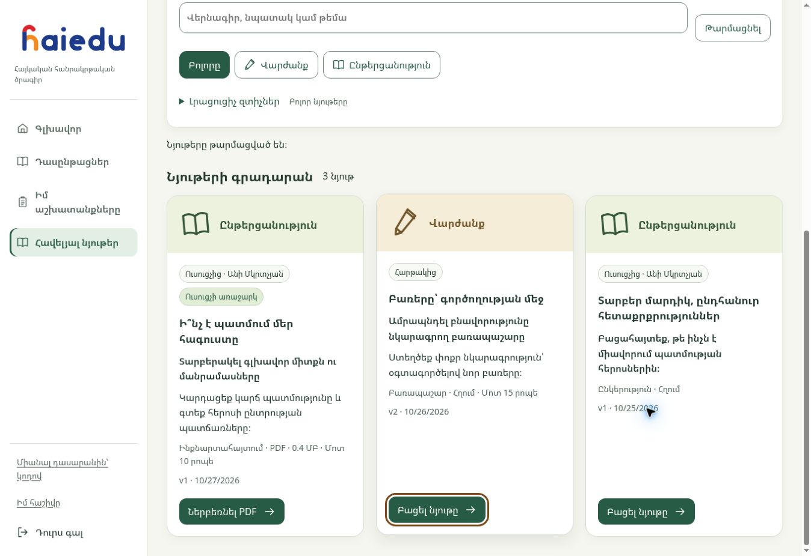

# Student dashboard acceptance — 27 October 2026

**16.5B.4 follow-up:** owner-reported subject symbols and account first-paint defects are corrected and deployed together with the public Forest palette. PR/main CI passes 1,464 unit/integration tests and 177 native-browser checks; seven changed production files match and fresh English/analytics checks pass. This is an evidenced follow-up to available-scope technical acceptance; final owner usability sign-off is not claimed. [Correction record](student-visual-corrections.md).

The complete implemented dashboard, including S45 «Հավելյալ նյութեր», has passed technical acceptance for the currently available Physics/English programmes and designated institutional fixtures. The deployed source is `ace33de8d0f82795614ed7b49ea4eef816be4baa` ([PR311](https://github.com/johnvanesyan-arch/HaiEdu/pull/311)). [Release evidence](evidence/student-supplementary-release-20261027.json) contains exact CI, backend, asset and authenticated-run receipts.

This is the final technical handoff for the current dashboard implementation. **Final owner usability sign-off on the live implementation is not inferred from earlier design approval. Full 16.5C/four-subject acceptance remains open** until Mathematics/Armenian and the formal cross-subject gate can actually be exercised. No new decision is needed to retain those existing dependencies; Sprint17 remains gated. Full browser zoom/device and broader usability/accessibility review also remain part of the formal gate; 200% text reflow is recorded accurately below.

## Coverage trace

All 45 stable IDs in the [coverage matrix](student-dashboard-function-coverage.md) are retained. The following groups trace every ID exactly once; a mapped future slot does not claim a working feature.

| IDs | Current implementation or preserved contract | Evidence / remaining dependency |
| --- | --- | --- |
| S01–S03 | Sign-in/out, account recovery/security, join/invitations | B.1/B.2 shared identity/account regressions and exact-production evidence; governed flows retained |
| S04–S08 | Authorized courses, explicit context, ordered unit navigation, resume/next action | Home/workspace browser regressions; fresh English/preserved-programme reads, retained Physics evidence and two-school isolation; no inferred cross-course score |
| S09–S12 | Diagnostic, Practice, Review, Mastery/readiness/attempt states | Existing lifecycle/response suites and prior full learner attempts reused; fresh read acceptance verifies current presentation/access; Unit3 action acceptance remains its next content task |
| S13–S17 | Response types, shared reading/listening, replay/technical exit, hints/guides | Required native response/arrangement/audio/guide regressions retained; source/policy/audio unchanged |
| S18–S20 | Writing discovery, draft/submission, returned revision and teacher feedback | Required writing browser/SQL/concurrency suites and previous Unit1/2 learner evidence reused; current teacher shortcuts preserve assignment context |
| S21–S22 | Course-scoped Progress/readiness and historical results | Workspace and preserved legacy route regressions; existing evidence models/history retained; duplicate main Progress stays removed |
| S23 | Speaking remains classroom-assessed | Existing disposition unchanged; broader human evidence is Sprint24.5 |
| S24–S30 | Privacy/deletion, denied access, deep links, no enrollment, loading/error and responsive/focus/motion | B.2 utility/workspace suites, all current 169 native checks, stale-account/editor regressions; no new deletion/auth policy |
| S31–S35 | Placement/progression, delivery-pending, previous-year history, recovery/transfer | Sprint18.5 owns APIs, migration and current/history fences; no live controls added |
| S36 | Longitudinal profile | Sprint23 authorized comparison/provenance projection required |
| S37–S38 | Notifications/assignments and teacher assessment/intervention | Sprint17/24.5 governed assignment and teacher workflows required; no fabricated inbox/deadline/count |
| S39 | Accommodations | Existing foundation retained; configured policy and owning acceptance still required |
| S40 | Learning growth/confidence/portability | Sprint18/24 versioned analytics and export contracts required |
| S41 | Controlled AI feedback | Sprint25 gateway, labels and subject governance required; no live AI control |
| S42 | Future subjects/grades/response types | Existing registered capability hooks retained; four-subject integration and new releases not implied |
| S43 | Armenian UI and future support/localization | Current Armenian messages retained; future support/ticket/localization remains Sprint18/19 |
| S44 | Optional goals/avatar/preferences | Proposal only; persistent account/event contract and separate owner decision remain |
| S45 | Complete supplementary-material library and authoring | New service, versioned QA/publication, private PDF/link delivery, native UI, PostgreSQL races and live two-school publication/revision/withdrawal |

## Verified behaviour and limits

Required PR/main CI passes five jobs, including 1,464 unit/integration tests and 169 native Chromium checks. The new materials cases use the actual author/student browser modules and actual handler/SQL behind synthetic authentication fixtures. Five real PostgreSQL 17 races cover competing revisions, duplicate publication, withdrawal versus delivery, assignment revocation and wall-clock expiry after lock waits. Existing account, response, writing, audio and institutional suites remain required. Typecheck, core parity and browser dependency guards pass.

Materials layouts pass 360/768/1280 px, 200% text at 360/640/768/1280 px, Armenian wrapping, focus retention and reduced motion. The final visual pass corrected large-text reflow and icon sizing. A delayed editor response cannot overwrite a newly opened draft; signed-out/changed-account responses cannot restore old private cards. Prior Home/subpage visual evidence is reused for unchanged CSS. This is not full WCAG certification, an actual-device survey or measured student engagement research.

Production has exact release and all 11 changed frontend assets. Eight SQL function bodies and all three Edge bundle files match source. The existing shared authentication helper is unchanged; only the new service consumes its new handler. The PDF bucket is private, PDF-only, 5 MiB, with no direct object policy. Authenticated downloads recheck current publication/context/session and verify bytes; withdrawal prevents subsequent delivery but cannot revoke downloaded files.

Live materials acceptance passes 73 outer checks plus tenant isolation before/after. Two designated teachers create synthetic resources, upload/QA/publish PDFs, verify own-student download and other-school denial, replace with an HTTPS version, and withdraw. Both synthetic resources are withdrawn and audit/file history remains private. The student library initially has no real materials until a teacher or platform reviewer explicitly publishes them. Platform publication/MFA is covered by isolated SQL/handler tests and the reused existing MFA interface; no new live platform content approval is claimed.

- [English Unit3 and preserved programme reads — 154 checks](https://github.com/johnvanesyan-arch/HaiEdu/actions/runs/40504378898), source `ace33de8d0f82795614ed7b49ea4eef816be4baa`; fresh current-release acceptance.
- [Staff actions — 143 checks](https://github.com/johnvanesyan-arch/HaiEdu/actions/runs/40502112158), source `ace33de8d0f82795614ed7b49ea4eef816be4baa`; fresh current-release acceptance.
- [Physics Chapters I–VI (reused) — 324 checks](https://github.com/johnvanesyan-arch/HaiEdu/actions/runs/40488926093), source `e7efc028d90e351270bec6606078b6867546db8c`; unchanged Physics read/runtime and subpage evidence reused; current shared navigation covered by 169 native regressions and fresh English/preserved-context reads.
- [Staff analytics (reused) — 10 checks](https://github.com/johnvanesyan-arch/HaiEdu/actions/runs/40491187762), source `e7efc028d90e351270bec6606078b6867546db8c`; unchanged analytics contract reused; current teacher navigation/actions freshly pass 143 checks.

The previously independently verified persistent Vercel Production/Blocking check is reused unchanged. The connector's existing team-scope limitation prevents a fresh management-settings readback; no bypass or release configuration change was made. Required CI plus exact assets and authenticated checks establish this delivery's evidence; Vercel READY alone is not treated as acceptance.

## Handoff

Students open «Հավելյալ նյութեր» immediately below «Իմ աշխատանքները»; teachers/content staff use the resource-library page or their selected-class shortcut. Keep actual content publication explicit. The complete dashboard is ready for the owner's usability review. Once the dashboard handoff is accepted, resume English at the recorded C47 bookmark: full Unit3 learner attempts, assessed audio limits/resume/unscored exits and W01 submission/teacher feedback, then Units4–6. Reuse previous content/audio approvals. Speaking stays classroom-assessed; independent specialist and formal-pilot gates remain distinct.

