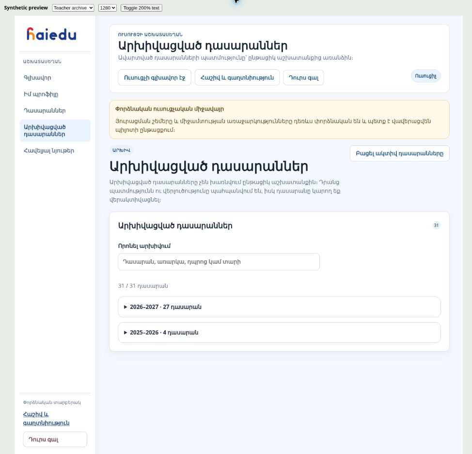

# Teacher account consistency, archives and design direction

2026-10-27 · Sprint 16.5B.5 · bounded implementation delivered at `69a8ae3aaf6af70394395bed8588021ba64753f0`; final reflow correction included in closure; broader design remains a proposal.

## Findings and bounded repair

The shared account route is intentional. B.4 incorrectly applied its Forest first-paint marker to every role. This change removes that unconditional marker, uses a neutral loading canvas, and applies the learner theme only after the authenticated account response identifies a student. Staff keep the current staff presentation and a role-appropriate return link. Sign-out/account switching invalidates pending account loads; delayed responses cannot restore the previous account's theme or content. Sharing this route does not share accounts or permissions.

The resource-library selector is derived from server-authorized assignment contexts. Production read-only inspection confirms that both dedicated QA teachers have active English and Physics subject authorizations and class assignments. Test Teacher 1 has one active English class, two active Physics classes and 27 archived Physics classes; Test Teacher 2 has one active class in each subject and 24 archived Physics classes. These are observed counts, not application limits. The English classes match the committed `docs/qa/additional-programme-fixtures.json` manifest. The shared SQL context guard checks the authenticated actor, live session, membership, subject authorization, programme, class, year, release and unit on reads and writes. A Physics-only teacher is not entitled to English merely because the materials exist.

This slice clarifies the selected recipient class/subject and explains who manages assignments. It does **not** revoke the dedicated QA teachers' English access or claim to make them Physics-only. Those identities remain dependencies of guarded production acceptance. The follow-up is a clean Physics-only demonstration account, separate from automated QA; alternatively, migrate the English QA assignment and its CI credentials to a distinct designated fixture first, then end the old assignment/authorization through supported school-admin workflows. Preserve existing work and audit history; do not delete assignments or hide granted access with subject-specific frontend logic. No credentials or private learner records are included in this document.

Teacher archives now use closed year groups, counts, search across class/subject/school/year, and twelve cards per expansion with an explicit load-more control. Card metadata includes subject and school. Existing class navigation, restore and evidence remain intact. School-admin archived teachers and academic years are collapsed with counts; ended teacher memberships already had a disclosure. The master-admin account archive already has a separate search/paginated view and is retained. Withdrawn/superseded resource versions move into a closed history group; published materials and drafts remain visible. History and audit workflows remain governed, not subject to generic deletion.

## Cross-role design proposal — not yet approved or implemented

Use one HaiEdu design system: Forest/cream, Armenian typography, spacing, buttons, focus styles, status language, subject-code artwork, empty/loading/error states, account and logout placement. Keep role-specific navigation and operational density. Shared design tokens must not be tied to a `student` role attribute. Common controls stay in predictable positions; each role's endpoints continue to decide access.

| Role | Home should prioritize | Shared relationship |
|---|---|---|
| Student | Continue learning, feedback, additional materials | Sees published work and feedback for the exact enrolled context |
| Teacher | Work awaiting review, classes, actionable support, sharing | Acts on assigned classes; can inspect a student-safe material preview |
| School admin | Staffing, assignments, invitations, school overview | Controls teacher subject/class scope and institutional lifecycle |
| Master admin | Platform health, governance, exceptions, audit | Governs platform content, account lifecycle and releases |

### Proposed delivery order

1. **Common staff shell and context:** apply approved Forest visual tokens through role-neutral components, keep school/year/class/subject visible, persistent account/logout and clear breadcrumbs; cover teacher, school-admin, master-admin and shared subpages together. Make a teacher Home/classes/review prototype reviewable before broad implementation.
2. **Teacher daily workspace:** an actionable review queue and compact class cards; counts link to their exact filter and show freshness. Use existing writing and analytics contracts. A cross-class queue/aggregate must have a scoped backend contract before appearing; do not infer an all-school total from a currently selected class. Add “continue reviewing” and stable back navigation.
3. **Review and material ergonomics:** reusable personal feedback snippets, rubric-first review, clear draft/sent states, keyboard navigation, recipient summary and student-safe preview. Draft autosave, batch publication or batch feedback require version/concurrency, scope and audit contracts; never silently send identical feedback to every learner. Existing supplementary publication is already real; proposed conveniences are not.
4. **Evidence-backed class insight:** compact skill patterns, explicit sample/coverage counts and small suggested support groups grounded in current analytics. Keep diagnostic, practice, mastery, writing and classroom-assessed speaking distinct; no invented progress percentages or teacher rankings. Test/demo accounts must be separated from everyday demonstration data.
5. **Polish:** restrained success feedback, readable mini charts, useful empty states, welcoming subject illustrations and subtle transitions respecting reduced motion. An optional “today's work completed” indicator can use actual reviewed work, without creating pressure through streaks, compulsory targets or decorative points.

Measure task completion and friction in a small teacher usability session: finding the next submission, sharing with the right class, restoring an archived class, returning to the original context, and understanding the next support action. Establish a baseline before claiming time savings or improved engagement. Prefer evidence of less work and more clarity to login-frequency targets.

A permanent-delete feature, if later approved, should begin with empty accidental drafts/test objects only, a dependency preview, explicit confirmation and audited authorization. Classes containing submissions, feedback or assessment evidence need the established retention/account-deletion rules; this slice uses folding rather than destructive cleanup.

## Acceptance and preservation

- Required PR/main CI and native Chromium regressions; responsive archive, keyboard disclosure, paging/search, class action, delayed student/staff account, service failure, signout and account-switch cases.
- Run browser dependency coverage and preserve main-only/designated-fixture guards. Fresh staff action acceptance for changed teacher/school pages; reuse unchanged content/backend/audio evidence explicitly.
- Verify production source/assets, merge closure documentation, then source-verify Notion synchronization.
- No schema, RLS, Edge deployment, content approval, replay-limit, scoring or account-assignment changes. All 45 student capabilities/dependencies and the English C47 bookmark remain. Full four-subject 16.5C and final owner usability approval remain open; this proposal does not authorize additional curriculum work.

References: [W3C consistent navigation](https://www.w3.org/WAI/WCAG22/Understanding/consistent-navigation.html) and [user-controlled interaction motion](https://www.w3.org/WAI/WCAG22/Understanding/animation-from-interactions.html). These guide the proposal; they are not a claim of complete WCAG certification.

## Verified delivery

[PR315](https://github.com/johnvanesyan-arch/HaiEdu/pull/315) merged after all five required [PR CI jobs](https://github.com/johnvanesyan-arch/HaiEdu/actions/runs/40537485952) passed. [Main CI](https://github.com/johnvanesyan-arch/HaiEdu/actions/runs/40538414159) also passed: 1,465 unit/integration and 185 native browser checks, PostgreSQL 17 and institutional concurrency, plus the aggregate release gate. The first PR browser run exposed a UTF-8 omission in the synthetic archive HTML; that fixture was corrected before merge and all 185 native cases passed. The initial local dependency-trigger failure was fixed and its focused suite passed; it is not represented as a fully passing initial local run.

The production stamp and all eleven initial changed frontend files match the implementation. [Fresh staff acceptance](https://github.com/johnvanesyan-arch/HaiEdu/actions/runs/40538414225) passes 147/147, including closed-group search, opening the exact run-created class and restoration. All four run-created classes were archived, both temporary memberships ended, invitations revoked and QA sessions closed. Existing QA English assignments were preserved. [Receipt](evidence/teacher-workspace-actions-20261027.json).

The final enlarged-text preview exposed pre-existing long-heading/count, notice and offscreen skip-link overflow. The closing batch fixes these in teacher/shared presentation CSS and extends the same three native archive cases at 320/768/1280 px to 200% text. The complete real teacher frontend with a synthetic adapter now measures 345 px content and scroll width in a 360 px iframe at 32 px root text. This is text reflow, not a claim of full browser zoom/device/WCAG certification. JavaScript, backend and business rules are unchanged from the live-tested implementation; the live action evidence is reused for this CSS follow-up, with fresh required CI and final production file readback.

[Release evidence](evidence/teacher-workspace-release-20261027.json) records the reused English/Physics/analytics/S45 evidence and the queued duplicate English run canceled before execution. The independently verified persistent Vercel blocking configuration in `reliability-stage1.md` is reused; a GitHub success or deployment success alone is not claimed as a fresh configuration audit.

